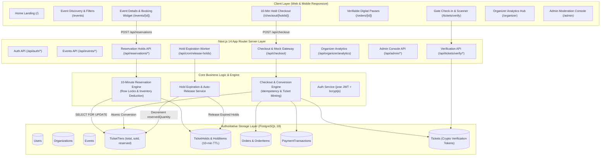

# THIGAZH (திகழ்) — System Architecture

**Tagline:** Events That Make You Shine.

---

## 1. Architectural Principles

THIGAZH is built as a single, coherent, full-stack application utilizing Next.js 14 App Router, TypeScript, Tailwind CSS, PostgreSQL 18, and Prisma ORM.

### Key Architectural Tenets:
1. **Zero Microservices Overengineering:** A modular monolith in one unified codebase minimizing operational complexity, serialization boundaries, and deployment friction.
2. **Authoritative Database Source of Truth:** PostgreSQL is the single source of truth for event scheduling, inventory calculations, temporary holds, and financial order completion.
3. **Strict Inventory Invariants:** Every ticket tier enforces:
   $$\text{available} = \text{totalQuantity} - \text{soldQuantity} - \text{reservedQuantity}$$
   Overselling is impossible even under high concurrency because inventory increments and conversions run inside serializable/read-committed transactions protected by PostgreSQL row-level locks (`SELECT ... FOR UPDATE`).
4. **Tenant Isolation:** Organizers can only inspect, modify, and query aggregated analytics for their own organization's events and orders. Attendees can only view their own reservations and digital tickets. Platform administrators have server-verified access to moderation actions.

---

## 2. High-Level System Architecture Diagram



---

## 3. Ten-Minute Reservation Engine Flow

```mermaid
sequenceDiagram
    autonumber
    actor Attendee
    participant Server as Next.js API (/api/reservations)
    participant DB as PostgreSQL 18
    participant Cron as Auto-Release Service

    Attendee->>Server: Request reservation (eventId, tiers, quantities)
    Server->>DB: Begin interactive transaction
    Server->>DB: Sweep stale expired holds
    Server->>DB: SELECT * FROM TicketTier WHERE id IN (...) FOR UPDATE
    Note over Server,DB: Tier rows locked; concurrent transactions queue safely
    Server->>Server: Check: requestedQuantity <= (total - sold - reserved)
    alt Insufficient Inventory
        Server->>DB: Rollback transaction
        Server-->>Attendee: 409 Conflict (Insufficient inventory)
    else Inventory Available
        Server->>DB: UPDATE TicketTier SET reservedQuantity = reservedQuantity + qty
        Server->>DB: INSERT INTO TicketHold (status=ACTIVE, expiresAt=now()+10m)
        Server->>DB: INSERT INTO TicketHoldItem (...)
        Server->>DB: Commit transaction
        Server-->>Attendee: Return holdId, expiresAt, and pricing breakdown
    end

    Note over Attendee: Attendee views 10-minute live countdown timer

    alt Attendee Completes Checkout within 10 minutes
        Attendee->>Server: Submit payment (holdId, idempotencyKey, simulation)
        Server->>DB: Begin checkout transaction with row lock on TicketHold
        Server->>Server: Verify hold is ACTIVE and not expired
        Server->>DB: Decrement reservedQuantity & Increment soldQuantity
        Server->>DB: UPDATE TicketHold SET status = CONVERTED
        Server->>DB: INSERT INTO Order (status=COMPLETED)
        Server->>DB: INSERT INTO Tickets (verificationToken, status=VALID)
        Server->>DB: Commit transaction
        Server-->>Attendee: Confirmed Order + Digital QR Tickets
    else 10 Minutes Elapse without Checkout
        Cron->>DB: Find active holds where expiresAt <= now()
        Cron->>DB: Lock hold row, UPDATE status = EXPIRED
        Cron->>DB: UPDATE TicketTier SET reservedQuantity = reservedQuantity - qty
        Note over DB: Reserved inventory safely restored for other buyers
    end
```

---

## 4. Security & Tenant Isolation

- **Authentication:** Standard JWT session encrypted via `jose` and stored in HTTP-Only, Secure, SameSite=Lax cookies (`thigazh_session`).
- **Role Model:** Distinct `ATTENDEE`, `ORGANIZER`, and `ADMIN` roles. Clients cannot promote their own roles.
- **Tenant Isolation:** All organizer queries filter by `organizationId IN (userOrganizations)`. Organizers cannot modify or view other hosts' events or bookings.
- **Idempotency:** Payment checkouts enforce unique client-supplied idempotency keys preventing double-charging or duplicate ticket minting.
- **Verification Integrity:** Digital tickets carry cryptographically unique verification tokens (`THG-XXXX-XXXX-XXXX`) and authentic QR codes verifiable at venue gates.
