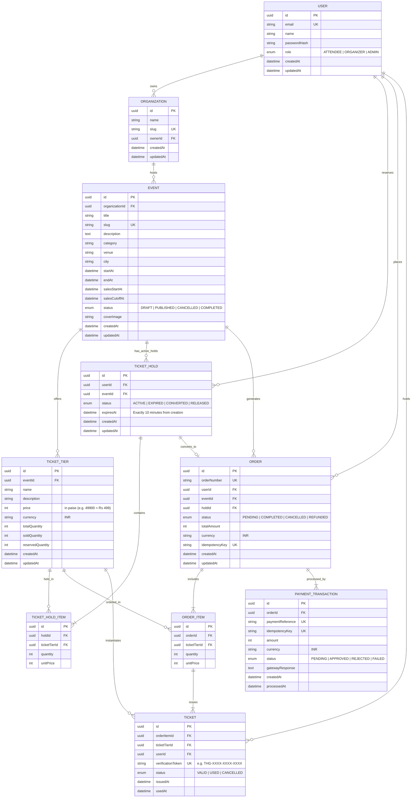

# THIGAZH (திகழ்) — Entity Relationship Diagram

This document illustrates the normalized relational database schema powering THIGAZH.

## Inventory Invariant
For every ticket tier in the database:
$$\text{available} = \text{totalQuantity} - \text{soldQuantity} - \text{reservedQuantity}$$
This invariant is strictly enforced at the database layer via interactive PostgreSQL transactions and row-level locking (`SELECT ... FOR UPDATE`).
